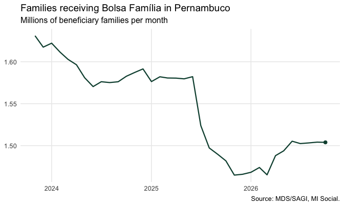
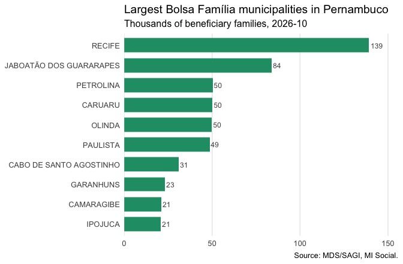

# Real-world example: Bolsa Família in Pernambuco

## Introduction

This vignette walks through a realistic analysis with misocialr: the
Bolsa Família programme in the state of Pernambuco — how many families
receive the benefit, how much is transferred, and how that is
distributed across municipalities.

``` r

library(misocialr)
library(dplyr)
library(tidyr)
library(ggplot2)
```

## Step 1 — Find the fields

The `bolsa_familia` theme of the dictionary says what is available and
what can be summed:

``` r

mds_fields("bolsa_familia")[, c("field", "label", "nature")]
#> # A tibble: 11 × 3
#>    field                                      label                       nature
#>    <chr>                                      <chr>                       <chr> 
#>  1 qtd_familias_beneficiarias_bolsa_familia_i Famílias beneficiárias do … estoq…
#>  2 qtd_pessoas_beneficiarias_bolsa_familia_i  Pessoas beneficiárias do B… estoq…
#>  3 valor_repassado_bolsa_familia_f            Valor repassado às família… fluxo 
#>  4 pbf_vlr_medio_benef_f                      Valor médio do benefício    média 
#>  5 familias_pbf_pobreza_i                     Famílias beneficiárias em … estoq…
#>  6 familias_pbf_extrema_pobreza_i             Famílias beneficiárias em … estoq…
#>  7 pbf_qtd_familias_indigenas_benef_i         Famílias indígenas benefic… estoq…
#>  8 pbf_qtd_benef_primeira_infancia_bpi_i      Benefícios Primeira Infânc… estoq…
#>  9 pbf_qtd_benef_gestantes_i                  Benefícios a gestantes      estoq…
#> 10 pbf_qtd_benef_7_a_17_anos_i                Benefícios a crianças e ad… estoq…
#> 11 pbf_perc_familias_benef_rf_mulher_d        Percentual de famílias ben… taxa
```

We will use the count of beneficiary families (`estoque`: it can be
summed across municipalities, not across months) and the value
transferred to them (`fluxo`: it can be summed across both).

## Step 2 — Retrieve three years of data

One call brings every municipality of Pernambuco (`"PE"`) for the last
36 months:

``` r

pbf <- mds_bolsa_familia(
  periods = -36,
  localities = "PE",
  fields = c("qtd_familias_beneficiarias_bolsa_familia_i",
             "valor_repassado_bolsa_familia_f")
)
pbf
#> # A tibble: 13,320 × 9
#>    locality_id ibge_code locality_name state period field      label unit  value
#>    <chr>       <chr>     <chr>         <chr> <chr>  <chr>      <chr> <chr> <dbl>
#>  1 260005      2600054   ABREU E LIMA  PE    202311 qtd_famil… Famí… Famí… 20443
#>  2 260005      2600054   ABREU E LIMA  PE    202312 qtd_famil… Famí… Famí… 20073
#>  3 260005      2600054   ABREU E LIMA  PE    202401 qtd_famil… Famí… Famí… 20144
#>  4 260005      2600054   ABREU E LIMA  PE    202402 qtd_famil… Famí… Famí… 19882
#>  5 260005      2600054   ABREU E LIMA  PE    202403 qtd_famil… Famí… Famí… 19700
#>  6 260005      2600054   ABREU E LIMA  PE    202404 qtd_famil… Famí… Famí… 19455
#>  7 260005      2600054   ABREU E LIMA  PE    202405 qtd_famil… Famí… Famí… 19311
#>  8 260005      2600054   ABREU E LIMA  PE    202406 qtd_famil… Famí… Famí… 18993
#>  9 260005      2600054   ABREU E LIMA  PE    202407 qtd_famil… Famí… Famí… 19034
#> 10 260005      2600054   ABREU E LIMA  PE    202408 qtd_famil… Famí… Famí… 18998
#> # ℹ 13,310 more rows
```

The API answers 0 for months not published yet, so the first thing to do
is remove that trailing tail. `reference = "brazil"` decides from the
whole country, which keeps legitimate zeros:

``` r

pbf <- mds_drop_unpublished(pbf, reference = "brazil")
range(pbf$period)
#> [1] "202311" "202610"
```

## Step 3 — The state series

Both fields have a nature that sums across municipalities, so the state
total is a plain sum by month:

``` r

state <- pbf |>
  summarise(value = sum(value), .by = c(period, field)) |>
  mutate(month = as.Date(paste0(period, "01"), "%Y%m%d"))

families <- filter(state,
                   field == "qtd_familias_beneficiarias_bolsa_familia_i")
```

``` r

ggplot(families, aes(month, value / 1e6)) +
  geom_line(color = "#0b4d3c", linewidth = 0.8) +
  geom_point(data = slice_tail(families, n = 1),
             color = "#0b4d3c", size = 2) +
  scale_y_continuous(labels = scales::label_number(accuracy = 0.01)) +
  labs(
    title = "Families receiving Bolsa Família in Pernambuco",
    subtitle = "Millions of beneficiary families per month",
    x = NULL, y = NULL,
    caption = "Source: MDS/SAGI, MI Social."
  ) +
  theme_minimal(base_size = 12) +
  theme(panel.grid.minor = element_blank())
```



plot of chunk unnamed-chunk-6

## Step 4 — Value per family, municipality by municipality

For the latest published month, put the two fields side by side and
compute the average transfer per family:

``` r

latest <- max(pbf$period)
per_family <- pbf |>
  filter(period == latest) |>
  pivot_wider(id_cols = c(ibge_code, locality_name),
              names_from = field, values_from = value) |>
  mutate(value_per_family =
           valor_repassado_bolsa_familia_f /
           qtd_familias_beneficiarias_bolsa_familia_i)

summary(per_family$value_per_family)
#>    Min. 1st Qu.  Median    Mean 3rd Qu.    Max. 
#>   743.1   767.7   777.2   777.7   786.5   815.5
```

The ten municipalities with the most beneficiary families:

``` r

top10 <- per_family |>
  slice_max(qtd_familias_beneficiarias_bolsa_familia_i, n = 10) |>
  mutate(locality_name = reorder(locality_name,
                                 qtd_familias_beneficiarias_bolsa_familia_i))

ggplot(top10,
       aes(qtd_familias_beneficiarias_bolsa_familia_i / 1e3,
           locality_name)) +
  geom_col(fill = "#209b74", width = 0.72) +
  geom_text(aes(label = scales::label_number(accuracy = 1,
                                             big.mark = ",")(
                  qtd_familias_beneficiarias_bolsa_familia_i / 1e3)),
            hjust = -0.15, size = 3.2, color = "grey30") +
  scale_x_continuous(expand = expansion(mult = c(0, 0.12))) +
  labs(
    title = "Largest Bolsa Família municipalities in Pernambuco",
    subtitle = paste0("Thousands of beneficiary families, ",
                      format(as.Date(paste0(latest, "01"), "%Y%m%d"),
                             "%Y-%m")),
    x = NULL, y = NULL,
    caption = "Source: MDS/SAGI, MI Social."
  ) +
  theme_minimal(base_size = 12) +
  theme(panel.grid.major.y = element_blank(),
        panel.grid.minor = element_blank())
```



plot of chunk unnamed-chunk-8

## Step 5 — Keep the provenance

Every retrieval records when it was made, which is worth keeping next to
any published figure:

``` r

attr(pbf, "retrieved_at")
#> [1] "2026-10-20 11:34:57 -03"
```

## Where to go next

- [`vignette("getting-started")`](https://strategicprojects.github.io/misocial/articles/getting-started.md)
  for the basic workflow.
- [`vignette("api-concepts")`](https://strategicprojects.github.io/misocial/articles/api-concepts.md)
  for what a document, a facet and an unpublished month are.
- [`mds_fields()`](https://strategicprojects.github.io/misocial/reference/mds_fields.md)
  for the other six themes: Cadastro Único, BPC, the SUAS network and
  its funding, conditionalities and food security.
